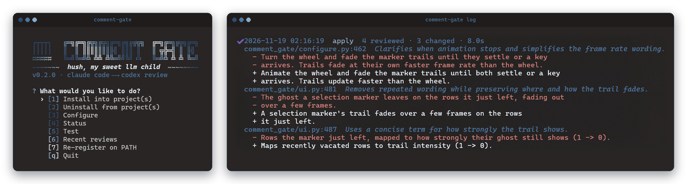

<p align="center">
  <picture>
    <source media="(prefers-color-scheme: dark)" srcset="media/logo-dark.webp">
    
  </picture>
</p>

<p align="center"><em>A second opinion on Claude's code comments.</em></p>

<p align="center">
  
  
  
</p>

<p align="center">
  
</p>

<p align="center"></p>

## How It Works

When Claude finishes a turn, comment-gate sends *only* the comments it added or changed to an OpenAI model through your Codex login. Redundant, obvious and chatty comments are removed or tightened. Rationale, caveats, API docs and tool directives stay.

Comment Gate ensures your code is never touched. Any edits that touch more than a comment get trashed!

## Install

You need Python 3.10+ and the [Codex CLI](https://github.com/openai/codex), logged in with `codex login`.

```sh
python comment-gate.py register   # adds `comment-gate` to your PATH
comment-gate install              # adds the hooks to the current project
```

Restart your Claude Code session afterwards. Run `comment-gate` on its own for an interactive menu covering install, status, a health check and recent reviews.

## Configure

`comment-gate config` opens a settings editor for the current project, and `--global` sets the defaults every project inherits.

| | |
|---|---|
| **Mode** | `apply` edits files in place, `suggest` hands the edits back to Claude, `report` only shows what would change |
| **Model** | The reviewer model and its reasoning effort |
| **Limits** | Timeout and batch sizes for large reviews |
| **Scope** | Which files are reviewed, and which comments are always left alone |

Set the environment variable `COMMENT_GATE=off` to turn it off. The full reference is in [AGENTS.md](AGENTS.md).

<p align="center"></p>
